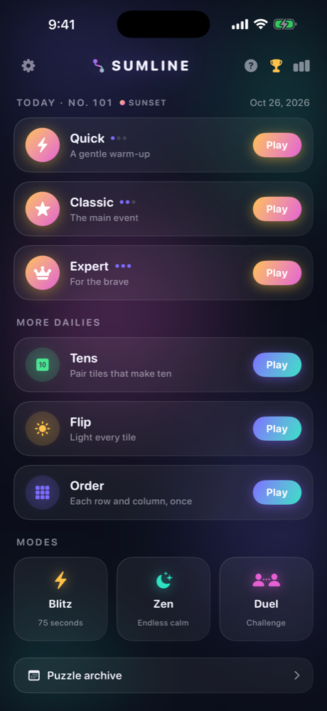
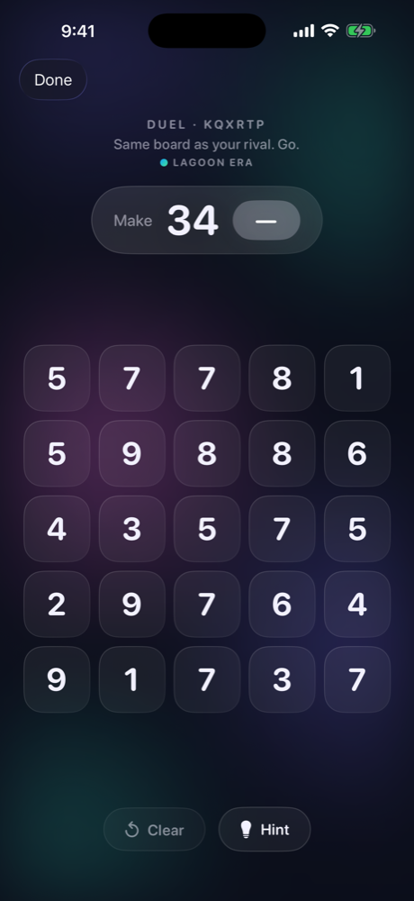
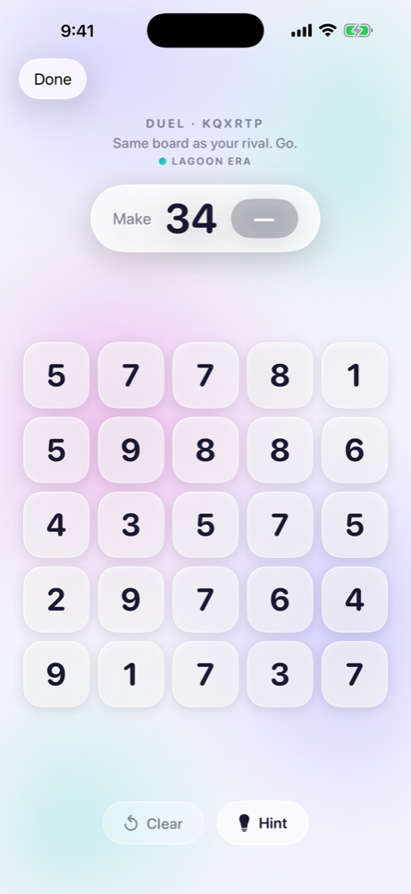
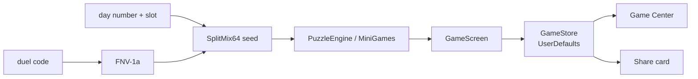

# Sumline

A daily number-puzzle hub for iPhone: draw one line through a grid so the numbers add up to the target, plus three mini dailies, Blitz, Zen and code-based duels. Every puzzle is generated on device, with no backend.

<p align="center">
  
  
  
</p>

## What it does

Each day everyone gets the same six puzzles, NYT Games style. Any solve keeps your streak; clearing the Quick / Classic / Expert trio earns a Perfect Day. The whole archive stays playable, so a missed day never locks you out.

## Features

- **Sumline trio** (Quick, Classic, Expert): drag one line through neighboring tiles so the sum hits the target exactly. Classic ramps in difficulty across the week.
- **Tens:** clear a 6x4 board by pairing tiles that sum to ten. Solvability is checked at generation with a memoized DFS.
- **Flip:** lights-out with a plus-shaped toggle and a daily par. Boards are built backwards from the solved state, so they are always solvable.
- **Order:** a 4x4 mini Latin square with a verified-unique solution.
- **Blitz** (75 seconds, +6 s per solve), **Zen** (endless, untimed) and an optional diagonal-moves rule.
- **Duels:** any 6-character code maps to the same board for everyone via an FNV-1a seed. Share `sumline://duel/CODE` and a friend plays your exact puzzle, still with no server.
- **Share cards:** `ImageRenderer` draws a 1080x1350 image of your path as an abstract fingerprint without spoiling the numbers.
- **Color eras:** the palette shifts every 10 levels across six themes.
- **Game Center leaderboards** for Blitz best, current streak and total solves.
- **Sumline+ (StoreKit 2):** every puzzle and mode stays free; Plus adds a Streak Shield, unlimited hints and extra stats.

## How it works



- `PuzzleEngine` seeds SplitMix64 with (day, slot), so every player sees the same puzzle. Day 1 is July 18, 2026; days flip at local midnight.
- `Models.swift`, `PuzzleEngine.swift` and `MiniGames.swift` are Foundation-only, so they can be compiled and tested from the command line with `swiftc`. The last validation run covered 1,095 dailies, 300 Zen, 300 Blitz and 200 duel boards, all deterministic and solvable, plus a year of mini dailies.
- Results, streaks and settings persist in `UserDefaults`.

## Tech stack

Swift 5, SwiftUI, iOS 17+, StoreKit 2, GameKit. No third-party dependencies.

## Open and build in Xcode

1. Open `Sumline.xcodeproj` in Xcode 16 or later.
2. Select the **Sumline** target → Signing & Capabilities and pick your own team (none is set in the repo). Change the bundle identifier if you plan to run on a device.
3. Choose an iPhone simulator running iOS 17+ and press **Run** (⌘R).
4. To test purchases locally, open Product → Scheme → Edit Scheme → Run → Options and set **StoreKit Configuration** to `SumlineProducts.storekit`.

Command-line build:

```sh
xcodebuild -project Sumline.xcodeproj -scheme Sumline -sdk iphonesimulator \
  -destination 'platform=iOS Simulator,name=iPhone 17' CODE_SIGNING_ALLOWED=NO build
```

### Game Center and in-app purchases

Leaderboards need Game Center enabled in App Store Connect with three integer leaderboards (highest wins): `sumline.blitz.best`, `sumline.streak.current`, `sumline.solves.total`. The entitlement is in `Support/Sumline.entitlements`.

Subscription product IDs (mirrored in `SumlineProducts.storekit`): `com.ianroyz.sumline.plus.monthly`, `.plus.yearly`, `.plus.lifetime`.

## Project structure

```
Sumline/
  SumlineApp.swift        app entry, deep-link handling
  PuzzleEngine.swift      seeded Sumline generator
  MiniGames.swift         Tens, Flip, Order engines
  Models.swift            puzzle, duel code, results
  GameStore.swift         persistence, streaks, hints
  PlusStore.swift         StoreKit 2
  GameCenterManager.swift leaderboards
  Theme.swift             Aurora design tokens and color eras
  Views/                  home, board, minis, Blitz, duel, stats, paywall, share cards
Support/                  Info.plist (URL scheme), entitlements
SumlineProducts.storekit  local StoreKit test config
docs/screenshots/         simulator captures
```

## Status

Feature-complete and builds clean for the iOS Simulator. Not yet released on the App Store; Game Center leaderboards and subscription products still need to be created in App Store Connect.

---

Built by [Ian Royes](https://github.com/ianroyes-sys)
